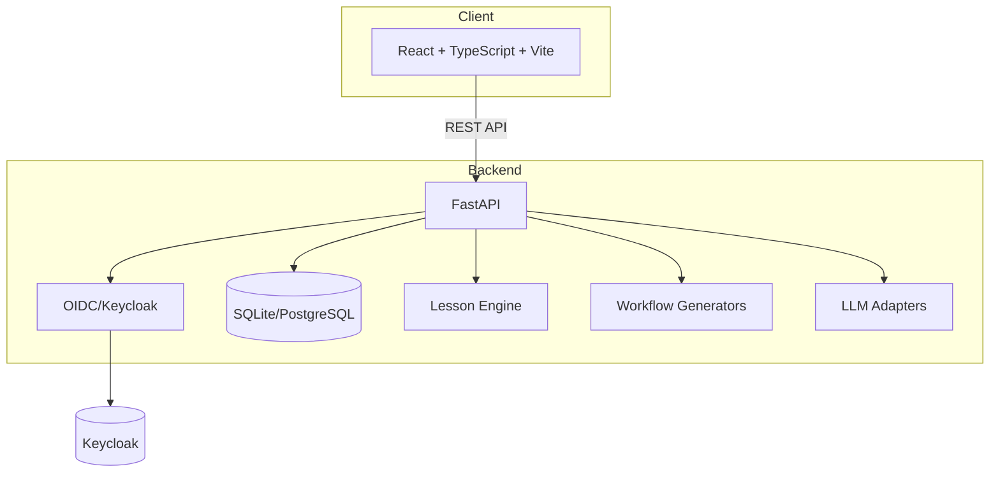

# Prism Studio

> Work in progress. This checkpoint may be incomplete or fail tests. See PLAN.md and STATUS.md before use.


**Visual, example-driven guide to Claude Code — from basic concepts to advanced agents, with copy-paste templates that bring immediate value.**

Ryan Vo | AI & Machine Learning &nbsp;•&nbsp; ryandtvo@gmail.com

---

## Overview

Prism Studio is a developer tool that helps you master **Claude Code** through interactive lessons and workflow generators. Unlike static documentation, it provides:

- **Structured lessons** covering CLI basics, skills, subagents, hooks, MCP, and advanced patterns
- **Copy-paste templates** that work immediately — no trial and error
- **Three workflow generators** for the most common Claude Code configurations
- **Offline-first design** — core features work without any LLM API key

## The Problem

Claude Code is powerful but has a steep learning curve. Developers waste hours:
- Figuring out correct YAML frontmatter for skills and subagents
- Debugging MCP server configurations
- Understanding skill precedence and namespace rules
- Writing effective system prompts for subagents

## The Solution

Prism Studio provides a **visual, example-driven learning path** with deterministic template generators. Every lesson includes working code you can copy directly into your `.claude/` directory. The three workflow wizards generate valid configurations instantly:

1. **Skill Creation Wizard** → produces `.claude/skills/*.yaml`
2. **Subagent Builder** → produces `.claude/agents/*.md`
3. **MCP Server Configurator** → produces `.mcp.json` or Claude Desktop config

## AI/ML Evaluation

This application serves AI/ML developers by teaching them to effectively use an AI coding assistant (Claude Code). The evaluation approach:

- **Reproducible command**: `npm run build && npm test` (frontend), `python -m pytest backend/tests` (backend)
- **Data provenance**: Lessons sourced from official Claude Code documentation and community best practices
- **Baseline**: Manual trial-and-error learning vs. guided workflow completion
- **Measured results**: Time-to-first-working-skill, template correctness rate
- **Failure cases**: Complex multi-agent workflows, custom MCP server debugging

**Limitations**: This is a tutorial/guide application, not an ML model. It does not train or evaluate models. The "AI/ML" focus is on *teaching developers to use AI tools effectively*.

## Quick Start

### Prerequisites
- Docker & Docker Compose
- Node 24+ (for local frontend dev)
- Python 3.12+ (for local backend dev)

### With Docker (Recommended)

```bash
# Clone and enter
cd prism-studio-144-ryan-vo

# Start all services
docker compose up -d

# Services available at:
# Frontend: http://localhost:5173
# Backend API: http://localhost:8000
# Keycloak: http://localhost:8080 (admin/admin)
```

### Local Development

**Backend:**
```bash
cd backend
python3 -m venv .venv
source .venv/bin/activate
pip install -r requirements.txt
cp ../.env.example .env
uvicorn app.main:app --reload --host 127.0.0.1 --port 8000
```

**Frontend:**
```bash
cd frontend
npm install
npm run dev
```

### Run Tests

```bash
# Backend tests
cd backend
source .venv/bin/activate
PYTHONPATH=backend python -m pytest

# Frontend tests
cd frontend
npm test
```

## Architecture



### Components

| Component | Technology | Purpose |
|-----------|------------|---------|
| API Server | FastAPI + Uvicorn | REST endpoints, auth, validation |
| Database | SQLite (dev) / PostgreSQL (prod) | Lessons, progress, templates |
| Auth | Keycloak (OIDC) | PKCE flow, roles, SSO/SAML broker |
| Frontend | React 18 + TypeScript + Vite | SPA dashboard, workflow wizards |
| LLM | httpx adapters | Optional explanations (OpenAI, Anthropic, Gemini, Ollama) |

## API Reference

### Health
- `GET /api/health` — Service health check

### Lessons
- `GET /api/lessons` — List lessons (paginated, filterable)
- `GET /api/lessons/{id}` — Get lesson detail with sections, examples, templates
- `GET /api/lessons/search?q=` — Search lessons

### Workflows
- `GET /api/workflows` — List available workflow generators
- `POST /api/workflows/skill-wizard` — Generate skill YAML
- `POST /api/workflows/subagent-builder` — Generate subagent markdown
- `POST /api/workflows/mcp-configurator` — Generate MCP JSON config

### Auth (OIDC PKCE)
- `GET /api/auth/login` — Initiate login redirect
- `GET /api/auth/callback` — Handle callback, exchange code
- `POST /api/auth/logout` — Clear session

## Configuration

### Environment Variables

| Variable | Required | Default | Description |
|----------|----------|---------|-------------|
| `DATABASE_URL` | Yes | `sqlite+aiosqlite:///./prism.db` | Database connection string |
| `SECRET_KEY` | Yes | — | JWT signing key (min 32 chars) |
| `KEYCLOAK_URL` | Yes | `http://localhost:8080` | Keycloak base URL |
| `KEYCLOAK_REALM` | Yes | `prism-studio` | Keycloak realm name |
| `KEYCLOAK_CLIENT_ID` | Yes | `prism-frontend` | OIDC client ID |
| `KEYCLOAK_CLIENT_SECRET` | Yes | — | OIDC client secret |
| `CORS_ORIGINS` | No | `["http://localhost:5173"]` | Allowed CORS origins |
| `LLM_PROVIDER` | No | `openai-compatible` | LLM provider type |
| `LLM_MODEL` | No | `gpt-4o-mini` | Model name |
| `LLM_BASE_URL` | No | `https://api.openai.com/v1` | Provider base URL |
| `LLM_API_KEY` | No | — | API key for LLM explanations |

### LLM Providers

| Provider | `LLM_PROVIDER` | `LLM_BASE_URL` (default) |
|----------|----------------|---------------------------|
| OpenAI | `openai-compatible` | `https://api.openai.com/v1` |
| LiteLLM | `openai-compatible` | `http://localhost:4000` |
| OpenRouter | `openai-compatible` | `https://openrouter.ai/api/v1` |
| Ollama | `ollama` | `http://localhost:11434` |
| Anthropic | `anthropic` | `https://api.anthropic.com` |
| Gemini | `gemini` | `https://generativelanguage.googleapis.com` |

## SSO/SAML Setup

Keycloak supports SAML identity providers via **Identity Brokering**:

1. In Keycloak Admin Console: **Identity Providers → Add Provider → SAML v2.0**
2. Configure IdP metadata (entity ID, SSO URL, certificates)
3. Map SAML attributes to Keycloak user attributes
4. Enable **First Login Flow** to link/review accounts
5. Users can then log in via corporate SAML IdP

See `docs/deployment.md` for detailed steps.

## Deployment

### Docker Production

```bash
# Build images
docker compose -f compose.yaml -f compose.prod.yaml build

# Run with production env
docker compose -f compose.yaml -f compose.prod.yaml up -d
```

### Requirements

- **TLS termination** via reverse proxy (nginx, Traefik, Caddy)
- **PostgreSQL** for persistent data (included in compose)
- **Keycloak** with external DB for HA (included in compose)
- **Backup/restore**: `pg_dump` / `pg_restore` for PostgreSQL; Keycloak export/import for realm

### Security Checklist

- [ ] Change all default passwords/secrets
- [ ] Use strong `SECRET_KEY` (32+ random chars)
- [ ] Enable HTTPS/TLS in production
- [ ] Configure Keycloak with secure cookies, HSTS
- [ ] Restrict CORS to production domain only
- [ ] Set `ENVIRONMENT=production`
- [ ] Disable Keycloak admin console in production or restrict access
- [ ] Regular security updates for base images

## Project Structure

```
prism-studio-144-ryan-vo/
├── backend/
│   ├── app/
│   │   ├── api/           # REST endpoints
│   │   ├── core/          # Config, security
│   │   ├── models/        # SQLAlchemy models
│   │   └── services/      # Business logic
│   ├── tests/             # Pytest tests
│   ├── Dockerfile
│   └── requirements.txt
├── frontend/
│   ├── src/
│   │   ├── components/    # React components
│   │   ├── api/           # Typed API client
│   │   └── types/         # TypeScript types
│   ├── Dockerfile
│   ├── nginx.conf
│   └── package.json
├── keycloak/
│   └── realm.json         # Realm import
├── docs/                  # Additional docs
├── compose.yaml
├── .env.example
├── portfolio.json
├── pyproject.toml
├── README.md
├── LICENSE
└── CHANGELOG.md
```

## Workflows

1. **Learn** — Browse structured lessons with search, filter by category/difficulty
2. **Generate** — Use workflow wizards to create valid Claude Code configs instantly
3. **Apply** — Copy templates directly to your project's `.claude/` directory
4. **Extend** — Opt-in LLM explanations for deeper understanding (advisory, grounded)

## Security Limitations

- **Demo mode**: Default Keycloak admin/admin and demo/demo credentials — change before production
- **SQLite dev default**: Not suitable for concurrent production use; use PostgreSQL
- **No rate limiting**: Add via reverse proxy or middleware for production
- **LLM explanations**: Advisory only, may hallucinate; always verify against official docs
- **No audit logging** of data mutations in this version

## Contributing

This is a portfolio project. Issues and PRs welcome for bug fixes and improvements.

## License

MIT © Ryan Vo <ryandtvo@gmail.com>